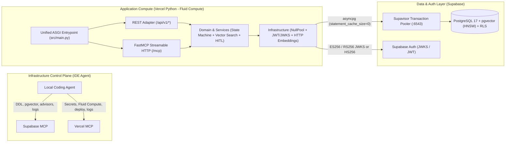
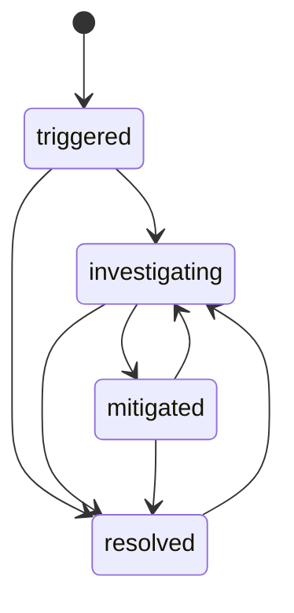

# Dual-Interface Incident & Runbook Control Plane

A production-ready operational control plane built with **Hexagonal Architecture** on **FastAPI** and **FastMCP (Stateless Streamable HTTP)**, backed by **Supabase PostgreSQL + `pgvector`** via **Supavisor transaction pooling**, and deployed to **Vercel Python Functions (Fluid Compute)**.

It operates on two complementary planes:

1. **Infrastructure Control Plane (DevOps via MCP):** Provision and audit Supabase migrations, `pgvector` HNSW indexes, Row-Level Security (RLS) advisors, and database logs via the hosted **Supabase MCP**, while configuring environment secrets, Fluid Compute settings, production deployments, and runtime logs via **Vercel MCP**.
2. **Application Runtime (Dual-Interface ASGI):** Serve versioned REST APIs (`/api/v1/*`) and purpose-built MCP tools, resources, and prompts (`/mcp`) from a single `src.main:app` ASGI entrypoint backed by identical domain services.

---

## Architecture



### Incident State Machine



All transitions are validated in `src/domain/state_machine.py` and atomically recorded to `public.incident_events` (enforced append-only via both RLS and a statement-level Postgres trigger).

---

## Repository Structure

```text
incident-control-plane/
├── pyproject.toml                   # Python >=3.12 deps & [tool.vercel] entrypoint
├── vercel.json                      # Fluid Compute, maxDuration=300, excludeFiles
├── .vercelignore                    # Excludes tests, migrations, local venvs from uploads
├── .env.example                     # Environment variable template
├── .mcp.json.example                # Remote Supabase & Vercel MCP client config
├── .github/workflows/ci-deploy.yml  # Ruff + Pytest CI and prebuilt Vercel deploy
├── supabase/migrations/
│   ├── 0001_enable_extensions_and_core_tables.sql
│   └── 0002_incident_events_statement_immutability.sql
├── scripts/
│   └── smoke_test_mcp.py            # Live REST + Streamable HTTP smoke test
├── src/
│   ├── main.py                      # Unified FastAPI + FastMCP ASGI entrypoint
│   ├── domain/                      # Pure entities, exceptions, state machine, ports
│   ├── services/                    # Shared application services (incident & runbook)
│   ├── infrastructure/              # Supavisor NullPool engine, ORM, JWT/JWKS, embeddings, HMAC tokens
│   └── adapters/
│       ├── rest/                    # FastAPI routers (/healthz, /readyz, /api/v1/*)
│       └── mcp/                     # FastMCP auth verifier, tools, resources, prompts
└── tests/
    ├── fakes.py                     # In-memory RLS-aware & cosine-similarity fakes
    ├── unit/                        # State machine, approval tokens, config, services
    └── integration/                 # Dual REST + Streamable HTTP MCP end-to-end tests
```

---

## Key Engineering Guarantees

- **Supavisor Serverless Pooling:** Configured with `sqlalchemy.pool.NullPool` and both `statement_cache_size=0` and `prepared_statement_cache_size=0` (`connect_args`) to prevent prepared statement collisions across pooled transaction boundaries (`port 6543`).
- **Database-Enforced RLS Isolation:** Each unit-of-work transaction applies `SET LOCAL ROLE authenticated` and `set_config('request.jwt.claims', ..., true)` so Supabase Row-Level Security isolates rows per `auth.uid()`.
- **Dual-Mode Human-in-the-Loop (HITL) Safety:** Under `MCP_STATELESS_HTTP=true` (required on Vercel serverless), high-risk steps in `execute_runbook_step` return a time-bounded, context-bound HMAC `approval_token` challenge (`status="confirmation_required"`). Consumed token JTIs are uniquely indexed in `incident_events` to prevent replay. In local stateful mode (`MCP_STATELESS_HTTP=false`), the adapter supports `ctx.elicit()` with automatic fallback to two-phase tokens on `2026-07-28` MCP connections.
- **Lean Vercel Bundle (< 500 MB):** Vector embeddings use lightweight `httpx` HTTP adapters (`openai`, `ai_gateway`, or `gemini`) rather than heavy local ML runtimes, and `vercel.json` / `.vercelignore` strip tests and migrations from the deployment bundle.

---

## Interfaces

### REST Endpoints (`/api/v1/*` & Health)

| Method & Path | `operation_id` | Description |
|---|---|---|
| `GET /healthz` | `liveness_probe` | Process & MCP mode liveness check |
| `GET /readyz` | `readiness_probe` | Live `SELECT 1` check via Supavisor |
| `POST /api/v1/incidents` | `create_incident` | Trigger incident + initial audit event |
| `GET /api/v1/incidents` | `list_incidents` | Filter by `status`, `severity`, `service_name` |
| `GET /api/v1/incidents/{incident_id}` | `get_incident` | Fetch incident + chronological `incident_events` |
| `POST /api/v1/incidents/{incident_id}/transition` | `transition_incident_status` | Validate state machine transition + audit log |
| `POST /api/v1/incidents/{incident_id}/diagnose` | `diagnose_incident` | Correlate telemetry with `pgvector` runbooks & postmortems |
| `POST /api/v1/runbooks` | `create_runbook` | Register and embed an operational runbook |
| `GET /api/v1/runbooks` | `list_runbooks` | List accessible runbooks |
| `GET /api/v1/runbooks/{slug}` | `get_runbook` | Retrieve runbook definition |
| `POST /api/v1/runbooks/{slug}/execute` | `execute_runbook_step` | Execute or challenge high-risk remediation step |
| `POST /api/v1/postmortems` | `create_postmortem` | Index historical post-mortem embedding |
| `POST /api/v1/postmortems/search` | `search_similar_postmortems` | Semantic search over post-mortems (`<=>` cosine distance) |

### MCP Endpoint (`/mcp` Streamable HTTP)

- **Tools:** `diagnose_incident`, `search_similar_postmortems`, `transition_incident_status`, `trigger_incident`, `execute_runbook_step`
- **Resources:** `incident://{incident_id}`, `runbook://{slug}`
- **Prompts:** `triage_incident`

---

## Local Setup & Verification

### 1. Connect Official DevOps MCP Servers

```bash
# Register hosted Supabase MCP
claude mcp add --scope project --transport http supabase "https://mcp.supabase.com/mcp?features=database,debugging,development,functions"

# Register Vercel MCP
npx add-mcp https://mcp.vercel.com
```

See [`.mcp.json.example`](.mcp.json.example) for a portable configuration template.

### 2. Install Dependencies & Run Tests

```powershell
python -m venv .venv
.\.venv\Scripts\python.exe -m pip install -e ".[dev]"
.\.venv\Scripts\ruff.exe check src tests
.\.venv\Scripts\pytest.exe -v
```

### 3. Run Locally & Inspect

```powershell
Copy-Item .env.example .env
# Populate DATABASE_URL (Supavisor port 6543), SUPABASE_URL, APPROVAL_SIGNING_SECRET, etc.
.\.venv\Scripts\uvicorn.exe src.main:app --reload
```

Run the smoke test script or launch **MCP Inspector**:

```powershell
.\.venv\Scripts\python.exe scripts\smoke_test_mcp.py --base-url http://127.0.0.1:8000 --token <bearer-token>
npx @modelcontextprotocol/inspector
```

Connect MCP Inspector using **Streamable HTTP** to `http://127.0.0.1:8000/mcp` (or your deployed `https://<your-project>.vercel.app/mcp`) with `Authorization: Bearer <token>`.

---

## Deployment to Vercel

```powershell
vercel link
vercel env add DATABASE_URL production
vercel env add SUPABASE_URL production
vercel env add APPROVAL_SIGNING_SECRET production
vercel env add EMBEDDING_API_KEY production
vercel deploy --prod
```

For GitHub Actions CI/CD (`.github/workflows/ci-deploy.yml`), configure repository secrets: `VERCEL_TOKEN`, `VERCEL_ORG_ID`, `VERCEL_PROJECT_ID`, and `SUPABASE_ACCESS_TOKEN`.
